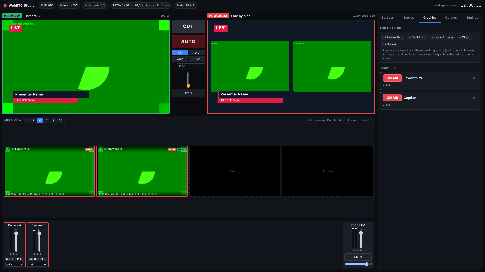
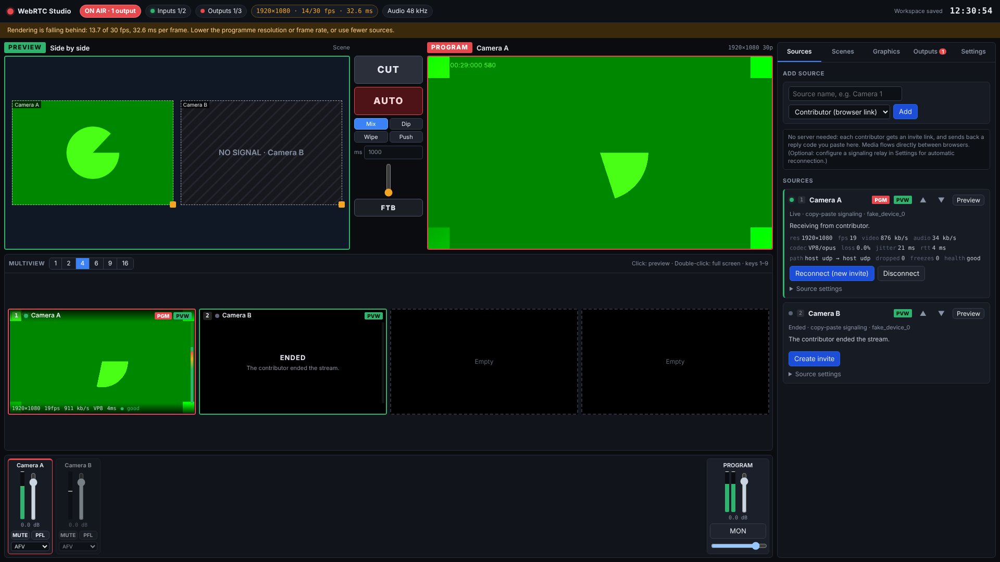
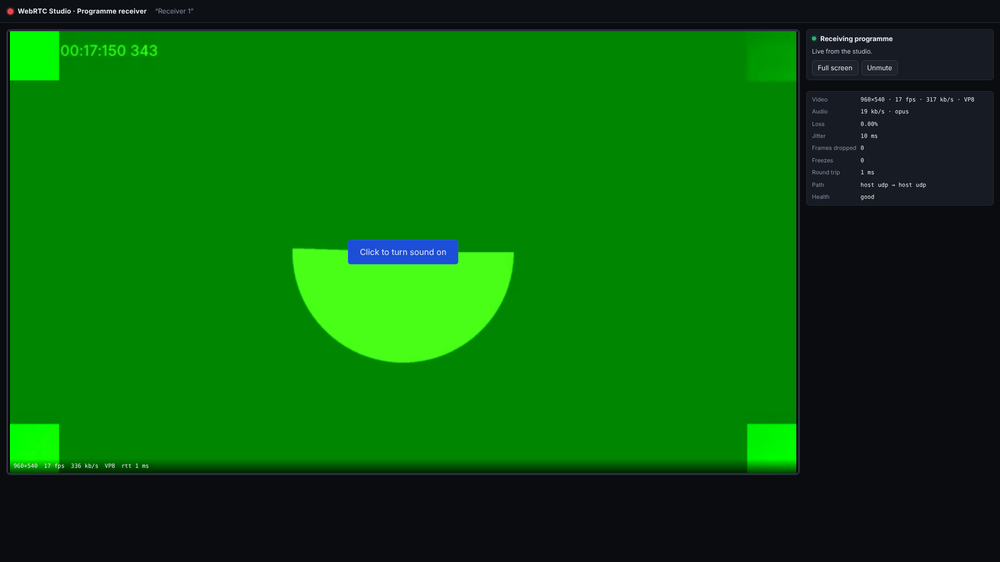

# WebRTC Studio

A browser-only live production studio. It receives remote WebRTC camera feeds,
shows them in a multiview, lets an operator build and switch a programme with
transitions, graphics and an audio mix, and publishes that programme as a real
outgoing WebRTC stream: to browser receivers, to any WHIP ingest server, or to
Twitch's WebRTC ingest. With the optional helper it can also send to RTMP.

All media work (decoding, compositing, mixing, encoding) happens in the
operator's browser. The app is a set of static files: no build step, no
dependencies, no backend. See [docs/LIMITATIONS.md](docs/LIMITATIONS.md) for
what that constraint costs and the optional helpers that soften it, and
[docs/TWITCH.md](docs/TWITCH.md) for the Twitch verification status.

## Run it

Open **https://mihneabont.github.io/webrtc-studio/** in Chrome or Edge. Browsers
only allow camera capture on HTTPS or `localhost`, so the pages are hosted
rather than opened from disk. Any static host works the same way.

Phones and laptops join as cameras by opening `contribute.html` from an invite
link. OBS on the studio computer can also join through OBS Virtual Camera.

To send from OBS or Larix directly (WHIP), the studio needs the small optional
helper running on the studio computer. Add an "OBS / WHIP encoder" source and
click **Install helper (Windows)**: the downloaded setup file installs Node.js
and ffmpeg if needed, runs the helper in the background on port 8788 (and at
every sign-in), and adds local-network firewall rules after one admin prompt.
Run it with `/uninstall` to remove the helper (ffmpeg stays installed). The top bar shows whether the helper is running; click it (or open
Settings → Helper) to turn it off or on, check again, or reinstall/update it. On
macOS or Linux: `node signaling-server/server.mjs --port 8788`.

The same helper sends the programme to **RTMP** servers (YouTube, Twitch,
Facebook…): add a **+ RTMP** output, paste the server URL and stream key, and
start it. A browser can't send RTMP by itself, so this output records the
programme and the helper's ffmpeg pushes it on. See docs/LIMITATIONS.md.

It also takes **SRT** senders (Larix, vMix, hardware encoders): add an *SRT (via
helper)* source and click **Start listening**. The helper listens on a UDP port
(9000 and up), and ffmpeg converts the stream to WebRTC for the studio page, so
any codec the sender uses works. See docs/LIMITATIONS.md.

Locally, without hosting: `node signaling-server/server.mjs --static . --port 8787`
serves the app and the helper together.

Use a current Chrome or Edge for the studio (H.264 encoding is needed for
Twitch). Contributors and receivers can use any current desktop or mobile
browser.

## Pages

| Page | Who opens it | What it does |
| --- | --- | --- |
| `index.html` | Operator | The control room |
| `contribute.html` | Each remote camera | Captures camera/mic or a screen and sends it to the studio, shows tally |
| `receive.html` | Anyone receiving the programme | Plays the programme output with live statistics |

## Operator workflow

1. **Add a source** (Sources tab). With no server configured, the studio creates
   an invite link. Send it to the contributor; they press *Join studio* and send
   back a reply code; paste it into the source card. Media then flows directly
   between the two browsers. WHEP sources take a URL instead.
   **YouTube** sources take a YouTube link: Connect loads YouTube's own player
   hidden inside the studio, and the studio captures just that player (Element
   Capture), so nothing is downloaded and no browser bar is in the picture. The
   browser asks once per source to share this tab. Play, pause, seek on the
   progress bar, restart, mute and loop from the source card. Its sound goes to
   the programme only, not to this computer's speakers. Needs Chrome or Edge
   132 or later (not available in Firefox).
   **OBS or another WHIP encoder** can be a source too: choose *OBS / WHIP
   encoder*, and the card shows a Server URL and Bearer Token to paste into OBS
   (Settings → Stream → Service: WHIP). This needs the optional helper running
   (see below), because a web page cannot receive OBS's HTTP request. The
   helper only passes the connection details on; the video goes straight from
   OBS to the studio browser.
   **SRT senders** work the same way through the helper: choose *SRT (via
   helper)*, click **Start listening**, and point the sender (mode Caller) at
   the address the card shows.
2. **Monitor** every source in the multiview (layouts 1/2/4/6/9/16). Each tile
   shows name, tally, connection state, resolution, frame rate, bitrate, RTT,
   health and an audio meter, or a diagnosis when there is no picture.
   Double-click for full screen.
3. **Preview** a source by clicking its tile (or keys 1-9), or a scene from the
   Scenes tab (Shift+1-9). Programme is untouched until you take.
4. **Take**: CUT (Space), AUTO (Enter) with Mix, Dip-to-black, Wipe or Push and a
   configurable duration, the T-bar for manual transitions, and FTB (B).
5. **Compose** scenes from templates (full, split, side by side, picture in
   picture, 2×2, 1+2, 3 across). Each layer has position, size, fit/fill/stretch,
   crop, border, rounded corners, opacity and an optional source label. Add text,
   images, logos and boxes. Put a scene in Preview to drag and resize its layers
   directly on the Preview monitor.
6. **Graphics** (keyed over the whole programme): lower thirds, text bugs,
   logos, clock and ticker, each with its own ON AIR toggle and fade.
7. **Audio**: one strip per source with fader, meter, mute, PFL and a mode
   (AFV = on air only while visible in Programme, Always on, Off). The master
   strip has L/R meters and an opt-in local monitor.
8. **Outputs**: set programme resolution and frame rate, then add browser
   receivers, WHIP endpoints or Twitch. Every output has its own connection,
   status, statistics, bitrate control and reconnect.

Everything except live connections is saved in the browser automatically and
restored on reload. Restored sources and outputs show as "not connected" until
you reconnect them.

## Architecture

```
 contributor browsers ──WebRTC──►┐
 WHEP endpoints ─────────WebRTC──►│  one RTCPeerConnection per source
                                  ▼
                  hidden <video> decoders ─┬─► multiview tiles
                                           ├─► Compositor (canvas 2D)
                                           │     Programme canvas ─captureStream─► video track
                                           │     Preview canvas (UI only)
                  remote audio tracks ─────┴─► Web Audio mixer ─► MediaStreamDestination ─► audio track
                                                                        │
                       programme video + audio tracks ◄─────────────────┘
                                  │  one RTCPeerConnection per output
                                  ├──► browser receivers (receive.html)
                                  ├──► WHIP ingest servers
                                  └──► Twitch (WHIP, H.264 + Opus)
```

- The Programme monitor in the UI *is* the captured canvas, so it always shows
  exactly what outputs send. UI chrome is never drawn into it.
- Switching, transitions and graphics only change what is drawn; outputs are
  never renegotiated. Bitrate changes apply live via `setParameters`.
- Rendering is driven by a Web Worker timer with back-pressure, so frames are
  dropped (not queued) when the machine is overloaded and the UI stays usable.
- All statistics come from `RTCPeerConnection.getStats()`. Fields the browser
  doesn't report are shown as "–", never estimated.

| File | Role |
| --- | --- |
| `js/sources.js` | Input connections, copy-paste and relay signaling, WHEP pull, reconnection, tally |
| `js/compositor.js` | Programme/Preview rendering, transitions, scene layers, graphics |
| `js/switcher.js` | Preview/Programme bus, Cut/Auto/T-bar/FTB, graphics keys |
| `js/audio.js` | Web Audio mixer |
| `js/outputs.js` | Programme outputs: receivers, WHIP, Twitch, RTMP (via the helper) |
| `js/rtc.js` | ICE config, gathering, codec preferences, stats, WHIP/WHEP client, failure diagnosis |
| `js/store.js` | Persistence (localStorage, IndexedDB for images, optional encrypted stream keys) |
| `js/ui/*` | Control-room UI |
| `signaling-server/server.mjs` | Optional helper (relay, OBS/WHIP ingest, SRT input, RTMP output); not needed for the rest of the app |

## Tests

The tests drive real browser pages connected by genuine WebRTC connections
(Chromium's fake camera and microphone stand in for the contributors' devices):

```sh
node signaling-server/server.mjs --static . &
node tests/e2e.mjs          # 25 checks: inputs, multiview, cut/auto, composition, audio,
                            # receiver output (pixel-checked), WHIP, failure isolation, reload
node tests/relay.mjs        # optional relay: reusable links, automatic reconnection
node tests/four-sources.mjs # load check with four 1080p contributors
node tests/obs.mjs          # OBS/WHIP encoder ingest via the helper (8 checks)
node tests/rtmp.mjs         # RTMP output via the helper's ffmpeg (needs ffmpeg; 9 checks)
node tests/helper-panel.mjs # helper status, turn off/on, update notice (static server on :8080; 13 checks)
```

Set `PLAYWRIGHT_DIR` to the folder containing the `playwright` package if it
isn't in `/opt/node-tools/node_modules/`.

## Acceptance criteria

| # | Criterion | Evidence |
| --- | --- | --- |
| 1 | Opens without a backend media service | Static files only; e2e test loads it from a plain file server |
| 2 | Connect two real remote WebRTC sources | e2e: two contributor pages connect via copy-paste signaling |
| 3 | View both simultaneously | e2e: both multiview tiles decoding |
| 4 | Preview without affecting Programme | e2e checks Programme before and after Preview changes |
| 5 | Cut | e2e |
| 6 | Auto transition | e2e |
| 7 | Composition with multiple sources and graphics | e2e: side-by-side scene + lower third + text key on air |
| 8 | Mix audio from incoming sources | e2e: both channels and the programme bus carry signal; mute verified |
| 9 | Publish composed video and audio over WebRTC | e2e: receiver output live |
| 10 | Received in a compatible remote client | e2e: receiver page decodes video and audio; pixels match the composition, a cut and FTB |
| 11 | Monitor health and troubleshoot | Per-source/output stats, health, ICE path, failure diagnosis; e2e checks failure isolation |
| 12 | Reload restores settings | e2e reloads and compares the workspace |
| Twitch | Broadcast to Twitch via WHIP | **Not verified**: see docs/TWITCH.md |

## Screenshots

From the automated test run (fake test cameras):




