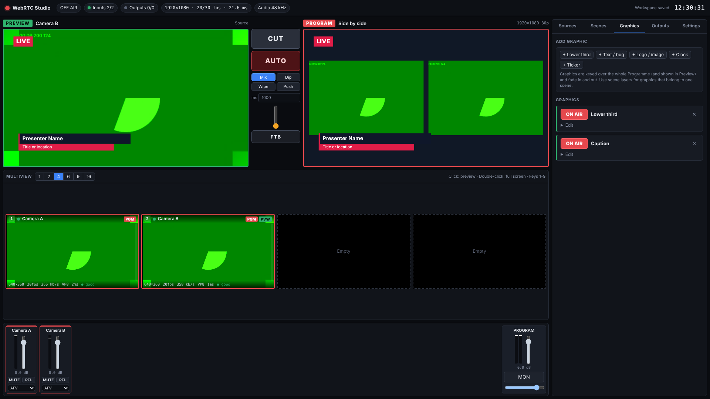
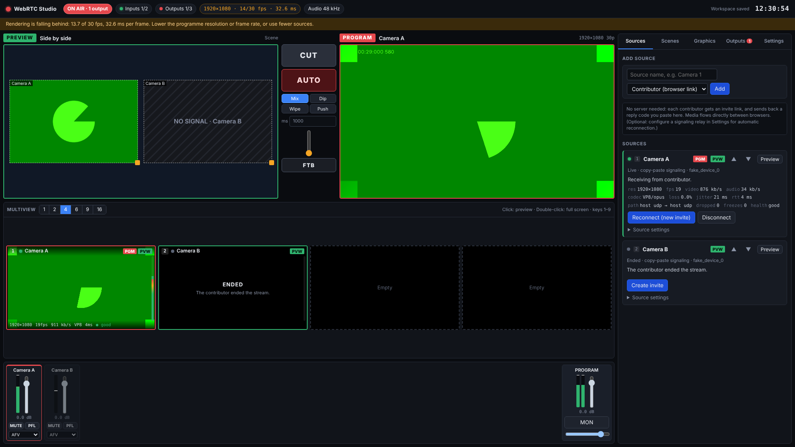
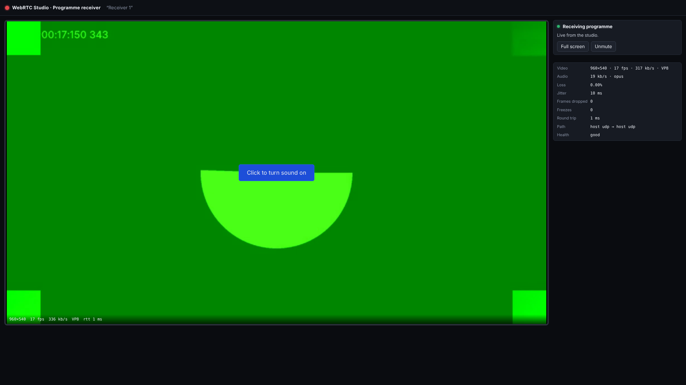

# WebRTC Studio

A browser-only live production studio. It receives remote WebRTC camera feeds,
shows them in a multiview, lets an operator build and switch a programme with
transitions, graphics and an audio mix, and publishes that programme as a real
outgoing WebRTC stream: to browser receivers, to any WHIP ingest server, or to
Twitch's WebRTC ingest. Several outputs can run at once.

All media work (decoding, compositing, mixing, encoding) happens in the
operator's browser. The app is a set of static files: no build step, no
dependencies, no media server, nothing to install. An optional small
[mailbox](mailbox/README.md) (a free Cloudflare Worker) adds WHIP input from
encoders such as OBS, reusable guest links and TURN; it only passes connection
details, never video. See
[docs/LIMITATIONS.md](docs/LIMITATIONS.md) for what that constraint costs, and
[docs/TWITCH.md](docs/TWITCH.md) for the Twitch verification status.

## Run it

Open **https://mihneabont.github.io/webrtc-studio/** in Chrome or Edge. Browsers
only allow camera capture on HTTPS or `localhost`, so the pages are hosted
rather than opened from disk. Any static host works the same way.

Phones and laptops join as cameras by opening `contribute.html` from an invite
link. Encoders such as OBS or Larix publish to a WHIP link from the studio
(needs the mailbox).

Locally, without hosting: `node tests/serve.mjs --port 8787` serves the files
at http://localhost:8787 (any static file server works).

Use a current Chrome or Edge for the studio (H.264 encoding is needed for
Twitch). Contributors and receivers can use any current desktop or mobile
browser.

## Pages

| Page | Who opens it | What it does |
| --- | --- | --- |
| `index.html` | Operator | The control room |
| `contribute.html` | Each remote camera | Captures camera/mic or a screen and sends it to the studio, shows tally |
| `receive.html` | Anyone receiving the programme | Plays the programme output with live statistics |

## Operator workflow

1. **Add a source** (Sources tab): an invite link, a WHEP stream, a WHIP
   encoder or a YouTube video. With the mailbox set up, an invite link is
   reusable: send it once, and the guest presses *Join studio* and reconnects by
   themselves after a refresh or a studio reload. Without it, the studio creates
   a one-time link; the guest sends back a reply code that you paste into the
   source card. Media flows directly between the two browsers either way. WHEP
   sources take a URL instead.
   **WHIP** sources give you a link to paste into OBS (Service: WHIP, Bearer
   Token empty), Larix or a hardware encoder, from any network, with no port
   forwarding. The encoder connects whenever it starts streaming while the
   studio is open.
   **YouTube** sources take a YouTube link: Connect opens a small window with
   YouTube's own player; click Start there and allow sharing. That window sends
   just its player to the studio (Element Capture: no browser bar), so nothing is
   downloaded. Each video has its own window, so several can run at once, each
   with its own sound on its own fader; the sound goes to the programme only, not
   to this computer's speakers. Play, pause, seek on the progress bar, restart,
   mute and loop from the source card. Keep the windows open (they can be behind
   others). Needs Chrome or Edge 132 or later, on Windows or macOS (not available in Firefox).
2. **Monitor** every source in the multiview (layouts 1/2/4/6/9/16). Each tile
   shows name, tally, connection state, resolution, frame rate, bitrate, RTT,
   health and an audio meter, or a diagnosis when there is no picture.
   Double-click for full screen.
3. **Preview** a source by clicking its tile (or keys 1-9), or a scene from the
   Scenes tab (Shift+1-9). Programme is untouched until you take.
4. **Take**: CUT (Space), AUTO (Enter) with Mix, Dip-to-black, Wipe or Push and a
   configurable duration, the T-bar for manual transitions, and FTB (B).
5. **Compose** scenes from templates (full, split, side by side, picture in
   picture, 2×2, 1+2, 3 across). Each layer has position, size, fit/fill/stretch,
   crop, border, rounded corners, opacity and an optional source label. Add text,
   images, logos and boxes. Put a scene in Preview to drag and resize its layers
   directly on the Preview monitor.
6. **Graphics** (keyed over the whole programme): lower thirds, text bugs,
   logos, clock and ticker, each with its own ON AIR toggle and fade.
7. **Audio**: one strip per source with fader, meter, mute, PFL and a mode
   (AFV = on air only while visible in Programme, Always on, Off). The master
   strip has L/R meters and an opt-in local monitor.
8. **Outputs**: set programme resolution and frame rate, then add browser
   receivers, WHIP endpoints or Twitch. Every output has its own connection,
   status, statistics, bitrate control and reconnect.

Everything except live connections is saved in the browser automatically and
restored on reload. Restored sources and outputs show as "not connected" until
you reconnect them.

## Architecture

```
 contributor browsers ──WebRTC──►┐
 WHEP endpoints ─────────WebRTC──►│  one RTCPeerConnection per source
                                  ▼
                  hidden <video> decoders ─┬─► multiview tiles
                                           ├─► Compositor (canvas 2D)
                                           │     Programme canvas ─captureStream─► video track
                                           │     Preview canvas (UI only)
                  remote audio tracks ─────┴─► Web Audio mixer ─► MediaStreamDestination ─► audio track
                                                                        │
                       programme video + audio tracks ◄─────────────────┘
                                  │  one RTCPeerConnection per output
                                  ├──► browser receivers (receive.html)
                                  ├──► WHIP ingest servers
                                  └──► Twitch (WHIP, H.264 + Opus)
```

- The Programme monitor in the UI *is* the captured canvas, so it always shows
  exactly what outputs send. UI chrome is never drawn into it.
- Switching, transitions and graphics only change what is drawn; outputs are
  never renegotiated. Bitrate changes apply live via `setParameters`.
- Rendering is driven by a Web Worker timer with back-pressure, so frames are
  dropped (not queued) when the machine is overloaded and the UI stays usable.
- All statistics come from `RTCPeerConnection.getStats()`. Fields the browser
  doesn't report are shown as "–", never estimated.

| File | Role |
| --- | --- |
| `js/sources.js` | Input connections: invites (reusable or copy-paste), WHIP through the mailbox, WHEP pull, YouTube windows, reconnection, tally |
| `js/mailbox.js` | WebSocket to the mailbox, used by the studio and the guest page |
| `mailbox/` | The mailbox: Cloudflare Worker for WHIP input, reusable links and TURN credentials |
| `js/compositor.js` | Programme/Preview rendering, transitions, scene layers, graphics |
| `js/switcher.js` | Preview/Programme bus, Cut/Auto/T-bar/FTB, graphics keys |
| `js/audio.js` | Web Audio mixer |
| `js/outputs.js` | Programme outputs: receivers, WHIP, Twitch |
| `js/rtc.js` | ICE config, gathering, codec preferences, stats, WHIP/WHEP client, failure diagnosis |
| `js/store.js` | Persistence (localStorage, IndexedDB for images, optional encrypted stream keys) |
| `js/ui/*` | Control-room UI |

## Tests

The tests drive real browser pages connected by genuine WebRTC connections
(Chromium's fake camera and microphone stand in for the contributors' devices):

```sh
node tests/serve.mjs --port 8787 &   # plain static file server (Node built-ins only)
node tests/e2e.mjs          # 25 checks: inputs, multiview, cut/auto, composition, audio,
                            # receiver output (pixel-checked), WHIP, failure isolation, reload
node tests/four-sources.mjs # load check with four 1080p contributors
(cd mailbox && npx wrangler dev --port 8790) &
node tests/mailbox.mjs      # 18 checks: WHIP input, reusable guest links, reloads
```

Set `PLAYWRIGHT_DIR` to the folder containing the `playwright` package if it
isn't in `/opt/node-tools/node_modules/`.

## Acceptance criteria

| # | Criterion | Evidence |
| --- | --- | --- |
| 1 | Opens without a backend media service | Static files only; e2e test loads it from a plain file server |
| 2 | Connect two real remote WebRTC sources | e2e: two contributor pages connect via copy-paste signaling |
| 3 | View both simultaneously | e2e: both multiview tiles decoding |
| 4 | Preview without affecting Programme | e2e checks Programme before and after Preview changes |
| 5 | Cut | e2e |
| 6 | Auto transition | e2e |
| 7 | Composition with multiple sources and graphics | e2e: side-by-side scene + lower third + text key on air |
| 8 | Mix audio from incoming sources | e2e: both channels and the programme bus carry signal; mute verified |
| 9 | Publish composed video and audio over WebRTC | e2e: receiver output live |
| 10 | Received in a compatible remote client | e2e: receiver page decodes video and audio; pixels match the composition, a cut and FTB |
| 11 | Monitor health and troubleshoot | Per-source/output stats, health, ICE path, failure diagnosis; e2e checks failure isolation |
| 12 | Reload restores settings | e2e reloads and compares the workspace |
| Twitch | Broadcast to Twitch via WHIP | **Not verified**: see docs/TWITCH.md |

## Screenshots

From the automated test run (fake test cameras):




